# Contacts V4

TP Android Kotlin — Ayoub Boussoukaya, L3 DSI

Application de gestion de contacts : base SQLite, préférences utilisateur, fragments et Google Maps.

## Fonctionnalités

- Contacts enregistrés dans une base SQLite `contacts.db` (SQLiteOpenHelper + DAO, requêtes avec `?`)
- Ajouter (bouton +), modifier, supprimer (avec confirmation) : tout est gardé après fermeture
- Filtre au fil de la saisie (nom, prénom, téléphone)
- Appel, e-mail, photo (galerie ou caméra), position sur la carte
- Paramètres : taille de police, couleur du texte, bouton Appeler dans la liste
- Bonus : colonne `favori` ajoutée en version 2 de la base (onUpgrade) et préférence « Ordre de tri »

## Lancer le projet

1. Ouvrir le dossier dans Android Studio (Gradle JDK 17 ou 21).
2. Pour la carte, ajouter sa clé Google Maps dans `local.properties` (ce fichier n'est pas envoyé sur GitHub) :
   ```
   MAPS_API_KEY=votre_cle
   ```
3. Lancer sur un émulateur avec Google Play.

## Captures

| Liste après relance | Création | Détail | Modification |
|:-:|:-:|:-:|:-:|
| 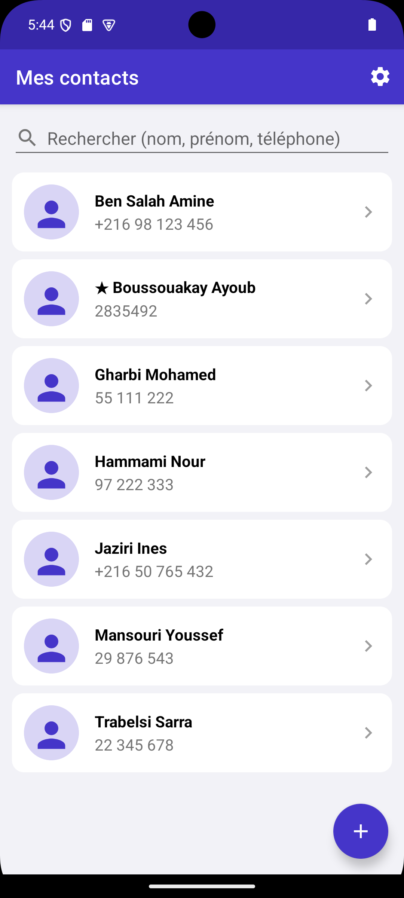 | 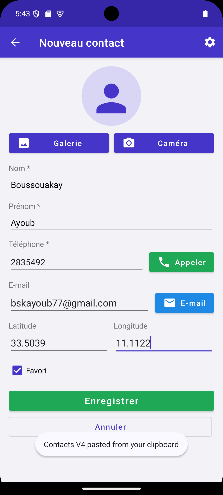 | 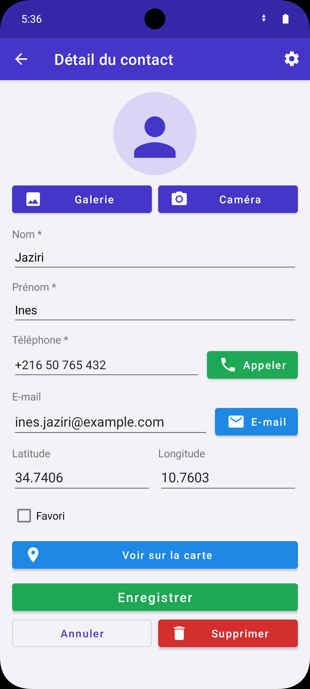 | 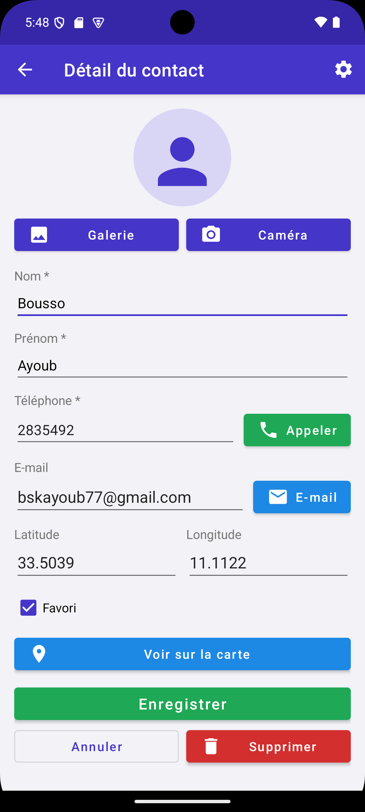 |

| Suppression | Paramètres | Couleur | Taille |
|:-:|:-:|:-:|:-:|
| 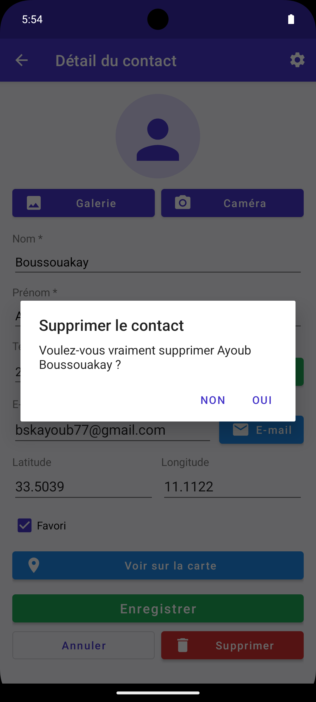 | 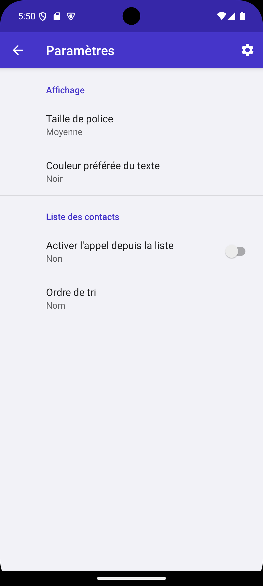 | 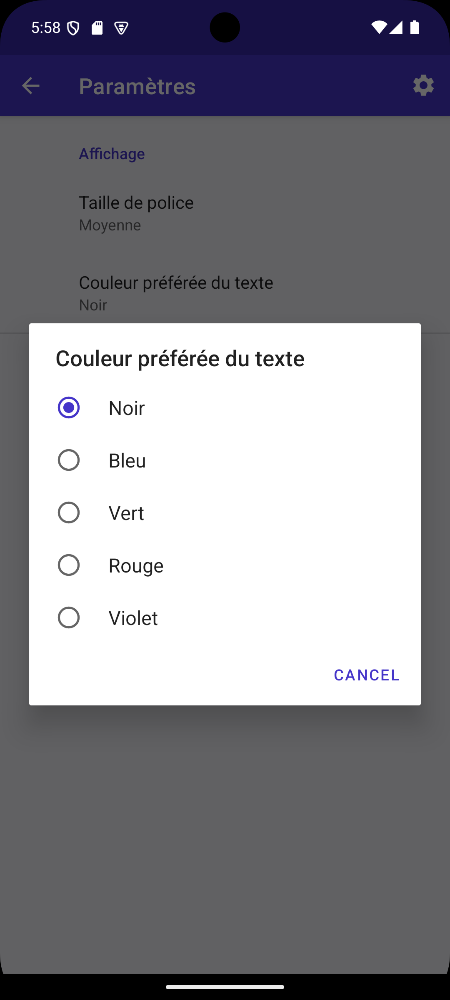 | 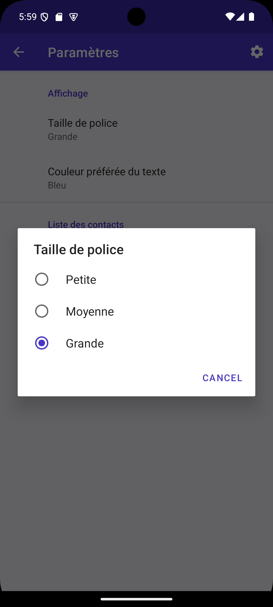 |

| Bleu, moyenne | Bleu, grande | Galerie | Permission caméra |
|:-:|:-:|:-:|:-:|
| 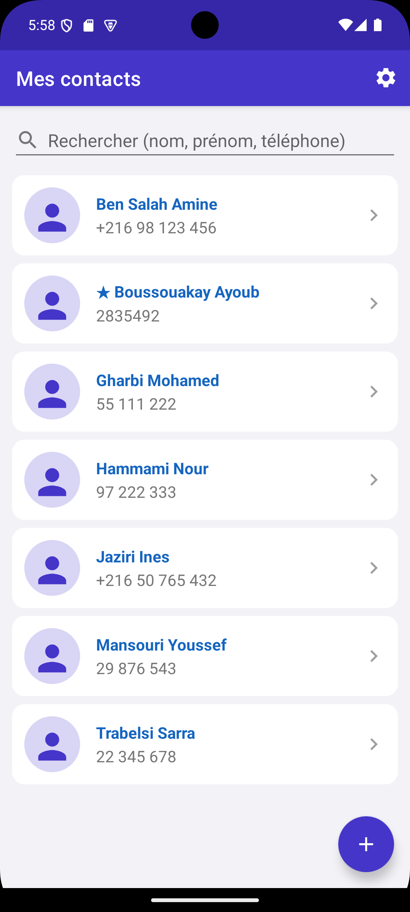 | 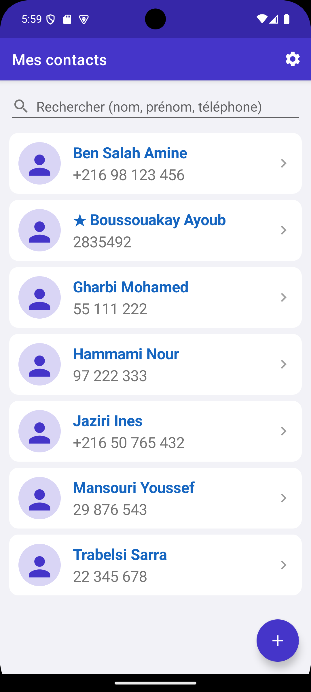 | 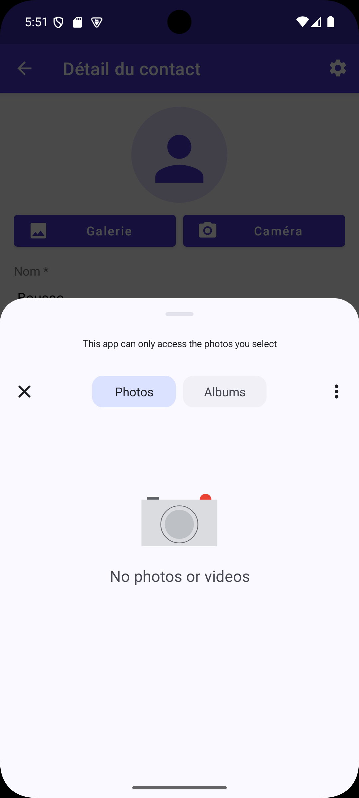 | 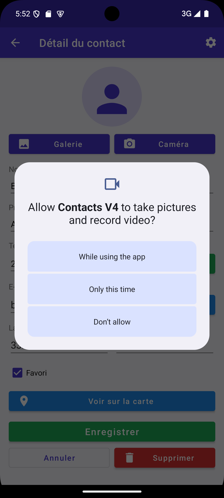 |

| Caméra | Composeur | Appel | E-mail |
|:-:|:-:|:-:|:-:|
| 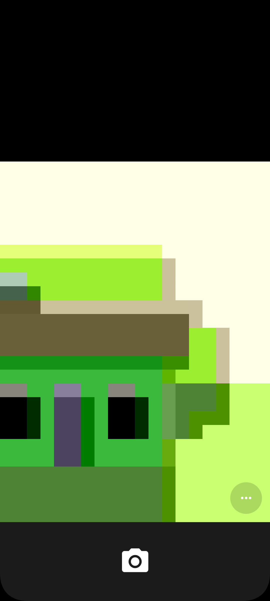 | 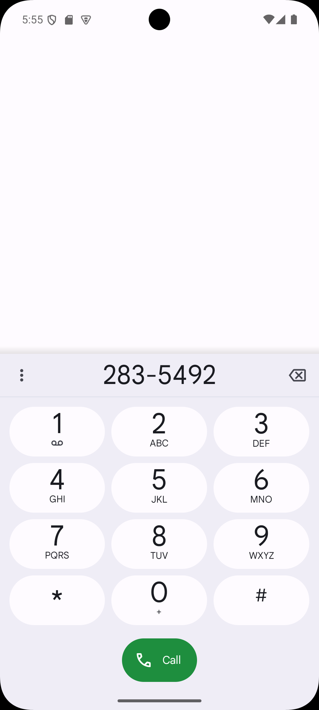 | 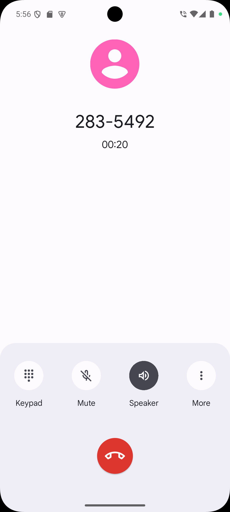 | 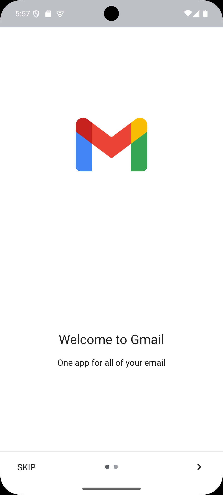 |

| Carte |
|:-:|
| 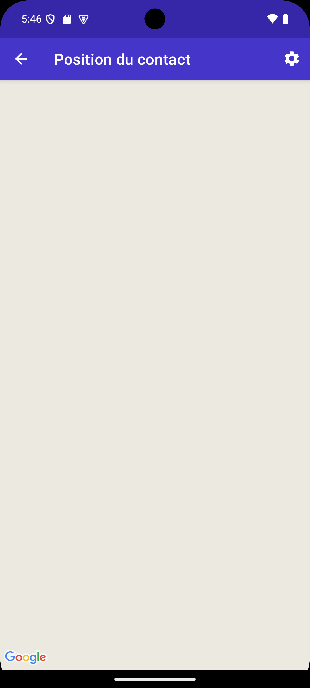 |
